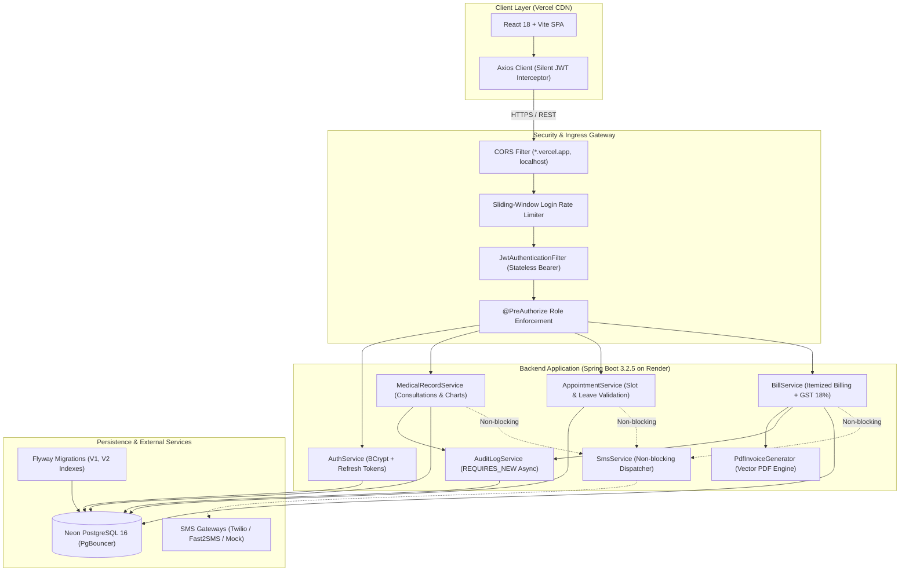

# SEBASETHU — Clinical & Hospital Management System

[](https://github.com/Abhigyan-19/Hospital-Management/actions/workflows/ci.yml)
[](https://spring.io/projects/spring-boot)
[](https://openjdk.org/projects/jdk/21/)
[](https://react.dev/)
[-00e599.svg)](https://neon.tech/)

**SEBASETHU** is a full-stack, enterprise-grade Hospital Management System engineered for modern healthcare facilities. It integrates clinical consultations, appointment double-booking safeguards, doctor working-hour constraints, itemized billing with GST calculation, vector PDF invoice generation, non-blocking multi-gateway SMS notifications, and server-side Role-Based Access Control (RBAC).

---

## 1. System Architecture



---

## 2. Core Functional Modules

### A. Authentication & Server-Side RBAC (Phase 1)
- **Role Hierarchy**: `ADMIN`, `DOCTOR`, `RECEPTIONIST`, `PATIENT`.
- **JWT Architecture**: Short-lived access tokens (30 minutes) + persistent cryptographically signed refresh tokens with automated silent rotation.
- **BCrypt Password Hashing**: Passwords stored as BCrypt salted hashes.
- **Rate Limiting**: Sliding-window IP rate limiter restricting failed login attempts to 5 per minute to mitigate brute-force attacks.
- **Granular Ownership Control**: Patients can only inspect their own records; doctors can only review their assigned patients and issue consultations for their appointments.

### B. Clinical Accountability & Audit Logging (Phase 2)
- Independent transactional audit logging (`Propagation.REQUIRES_NEW`) recording user ID, actor name, role, action, target entity, record ID, IP address (`X-Forwarded-For`), and timestamp.
- Dedicated Admin Audit portal with date filtering.

### C. Clinical Depth & Scheduling Controls (Phase 3)
- **Electronic Health Records**: Complete `medical_record` schema storing diagnoses, symptoms, vitals, and physician notes.
- **Patient Clinical Fields**: Patient `blood_group`, `allergies`, and emergency contacts.
- **Doctor Availability Engine**: Configurable weekly working days, operating hours, slot intervals, and vacation/leave dates.
- **Double-Booking Safeguards**: Server-side conflict detection preventing concurrent bookings for the same clinician.
- **Rescheduling & Cancellation**: Automated slot validation and status updates accompanied by SMS alerts.

### D. Itemized Billing & PDF Invoices (Phase 4)
- **Itemized Structure**: Child `bill_items` table tracking descriptions, unit prices, quantities, and totals.
- **Tax / GST Calculation**: Automatic calculation of 18% GST with configurable rates and financial subtotaling.
- **Payment Lifecycle**: Multi-channel payment recording (`CASH`, `CARD`, `UPI`) with verified payment timestamps.
- **Zero-Dependency PDF Engine**: Pure Java vector PDF 1.4 invoice generator rendering hospital branding, patient metadata, item tables, GST breakdown, and receipt stamps.

### E. Reliability, Observability & CI (Phase 5)
- **Test Suite**: Comprehensive JUnit 5 and Mockito service unit tests and Spring Boot integration tests running against an in-memory test profile.
- **Flyway Migrations**: Version-controlled migrations (`V1__init_schema.sql`, `V2__add_indexes.sql`) for reproducible database setups.
- **Performance Indexes**: Database indexes on frequently searched columns (`doctor_id, date, time`, `patient_id, status`, `invoice_number`, `timestamp`).
- **Observability**: Spring Boot Actuator (`/actuator/health`, `/actuator/metrics`) and structured Logback logging.
- **API Documentation**: OpenAPI / Swagger UI at `/swagger-ui.html`.
- **Automated CI**: GitHub Actions workflow testing backend and frontend on every push.

---

## 3. Environment Variables Reference

| Variable | Default Value | Description |
| :--- | :--- | :--- |
| `PORT` | `8080` | Backend HTTP listening port (configured dynamically by Render) |
| `SPRING_DATASOURCE_URL` | `jdbc:postgresql://localhost:5432/hospital` | PostgreSQL connection URL (e.g. Neon connection string) |
| `SPRING_DATASOURCE_USERNAME` | `postgres` | Database username |
| `SPRING_DATASOURCE_PASSWORD` | `postgres` | Database password |
| `CORS_ALLOWED_ORIGINS` | `http://localhost:5173,https://*.vercel.app` | Comma-separated list of allowed CORS origins |
| `JWT_SECRET` | *(64-byte Hex)* | HMAC-SHA512 secret key used for signing JWT tokens |
| `JWT_EXPIRATION_MS` | `1800000` | Access token lifespan (30 minutes) |
| `JWT_REFRESH_EXPIRATION_MS`| `604800000` | Refresh token lifespan (7 days) |
| `HOSPITAL_SENDER_PHONE` | `+91 7890100849` | Hospital helpline & SMS sender identity |
| `SMS_PROVIDER` | `mock` | SMS provider selector (`mock`, `twilio`, `fast2sms`) |
| `TWILIO_ACCOUNT_SID` | *(empty)* | Twilio Account SID (when `SMS_PROVIDER=twilio`) |
| `TWILIO_AUTH_TOKEN` | *(empty)* | Twilio Auth Token (when `SMS_PROVIDER=twilio`) |
| `TWILIO_FROM_PHONE` | `+917890100849` | Twilio registered sender number |
| `FAST2SMS_API_KEY` | *(empty)* | Fast2SMS authorization key (when `SMS_PROVIDER=fast2sms`) |
| `FLYWAY_ENABLED` | `true` | Toggle for automated Flyway migrations on startup |

---

## 4. Setup & Running Locally

### Prerequisites
- **Java 21 LTS** (`javac -version`)
- **Node.js 18+** & npm (`npm -v`)
- **PostgreSQL 15+** (or Neon cloud database)

### Backend Setup
1. Clone the repository and checkout the active branch:
   ```bash
   git clone https://github.com/Abhigyan-19/Hospital-Management.git
   cd Hospital-Management
   git checkout Arintak_work
   ```
2. Configure local environment variables or update `src/main/resources/application.properties`.
3. Build and execute tests:
   ```bash
   ./mvnw clean test
   ```
4. Run the application:
   ```bash
   ./mvnw spring-boot:run
   ```
   The backend starts at `http://localhost:8080`.

### Frontend Setup
1. Navigate to the frontend directory:
   ```bash
   cd frontend
   npm install
   ```
2. Start the Vite development server:
   ```bash
   npm run dev
   ```
   The application opens at `http://localhost:5173`.

### Demo User Accounts (Pre-seeded)
| Role | Email | Password | Assigned Identity |
| :--- | :--- | :--- | :--- |
| **Admin** | `admin@sebasethu.health` | `demo123` | Hospital Administrator |
| **Doctor** | `doctor@sebasethu.health` | `demo123` | Dr. Anika Sharma (Cardiology) |
| **Patient** | `patient@sebasethu.health` | `demo123` | Maya Iyer (Patient #1) |
| **Receptionist** | `reception@sebasethu.health` | `demo123` | Front Desk Team |

---

## 5. API Overview

All authenticated endpoints require an `Authorization: Bearer <token>` HTTP header.

### Authentication (`/auth`)
- `POST /auth/login`: Authenticate email and password; returns access & refresh tokens.
- `POST /auth/refresh`: Exchange valid refresh token for a new access token.
- `GET /auth/me`: Retrieve authenticated user profile and roles.
- `POST /auth/change-password`: Update account password.

### Clinical & Consultations (`/doctors/me`, `/medical-records`)
- `GET /doctors/me/availability`: Retrieve doctor's consultation schedule and leave dates.
- `PATCH /doctors/me/availability`: Update working hours and planned leave.
- `GET /doctors/me/patients`: List patients assigned to doctor.
- `GET /doctors/me/patients/{patientId}/chart`: Full clinical chart (demographics, allergies, visits, prescriptions).
- `POST /doctors/me/appointments/{appointmentId}/consultation`: Save diagnosis, clinical notes, and prescriptions; marks visit as completed.
- `GET /medical-records/patient/{patientId}`: Scoped clinical history for patient.

### Appointments (`/appointments`, `/appointments/me`, `/reception`)
- `GET /appointments`: Role-filtered appointment schedule.
- `POST /appointments`: Book new consultation (validates availability and blocks double-booking).
- `PATCH /appointments/{id}/reschedule`: Reschedule appointment to a new slot with SMS notification.
- `PUT /appointments/{id}/status?status=Cancelled`: Cancel appointment with SMS notification.
- `POST /reception/appointments/{id}/check-in`: Check in arriving patient.

### Billing & Invoices (`/bills`, `/reception/invoices`)
- `GET /bills`: List hospital invoices (`ADMIN`, `RECEPTIONIST`).
- `POST /bills`: Generate itemized bill with line items and 18% GST calculation.
- `PATCH /bills/{id}/payment`: Record payment method (`CASH`, `CARD`, `UPI`) with timestamp.
- `GET /bills/{id}/pdf`: Download vector PDF invoice with receipt stamp.
- `GET /patients/me/linked/{patientId}/invoices/{id}/pdf`: Patient download of personal invoice.

### System & Health (`/actuator`, `/swagger-ui.html`)
- `GET /actuator/health`: System health status (public).
- `GET /swagger-ui.html`: Interactive OpenAPI 3 / Swagger documentation.

---

## 6. Known Limitations & Roadmap

### Known Limitations
1. **SMS Gateway Credentials**: In local and development deployments, the application defaults to simulated SMS logging (`SMS_PROVIDER=mock`). Valid Twilio or Fast2SMS credentials must be provided in production environment variables to dispatch real cellular SMS messages.
2. **Payment Gateway Integration**: Payments are recorded, verified, and stamped via clinical reception workflows (`CASH`, `CARD`, `UPI`). Real-time payment gateway webhooks (e.g., Razorpay, Stripe) are slated for subsequent integration.
3. **Multi-Hospital Tenancy**: The current database architecture is optimized for single-institution hospital deployments.

### Future Roadmap
- [ ] **Direct Payment Gateway Webhooks**: Integration with Razorpay / Stripe for online patient copayments.
- [ ] **DICOM Imaging Viewer**: Web-based PACS/DICOM viewer for radiological scans in the patient chart.
- [ ] **Automated SMS Reminders**: Background cron scheduling sending 24-hour appointment reminder alerts.
- [ ] **Laboratory Information Management System (LIMS)**: Direct integration of automated lab analyzers and report uploads.
